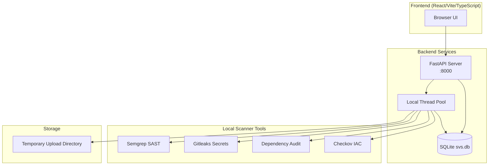
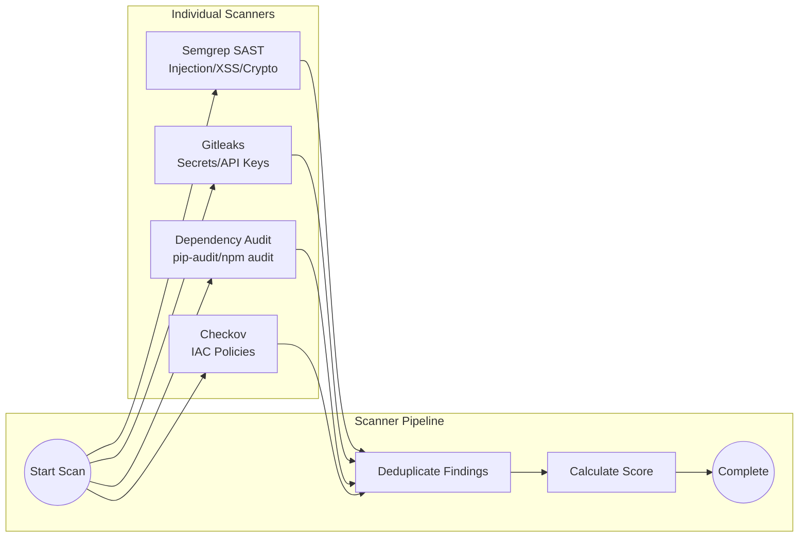
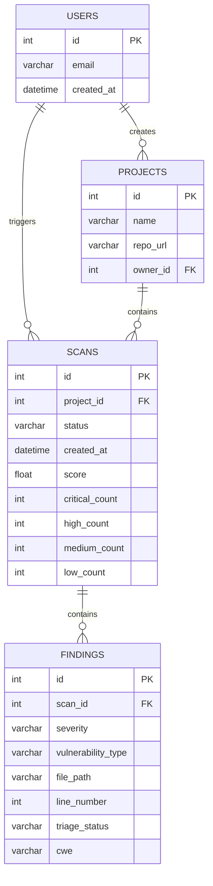
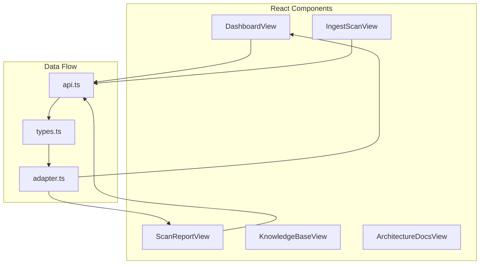
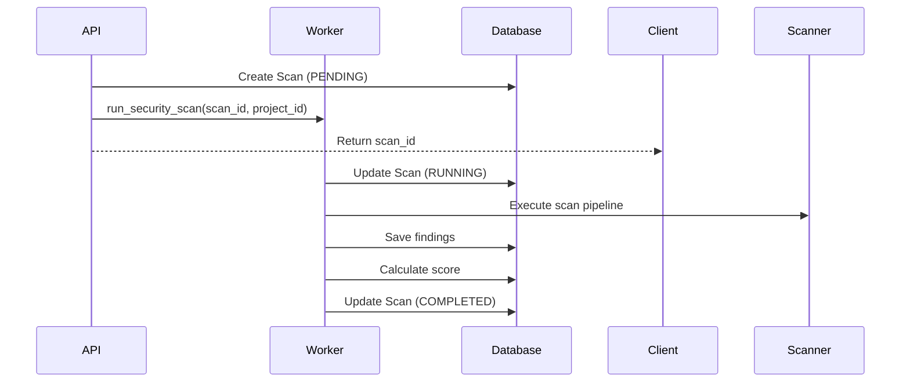
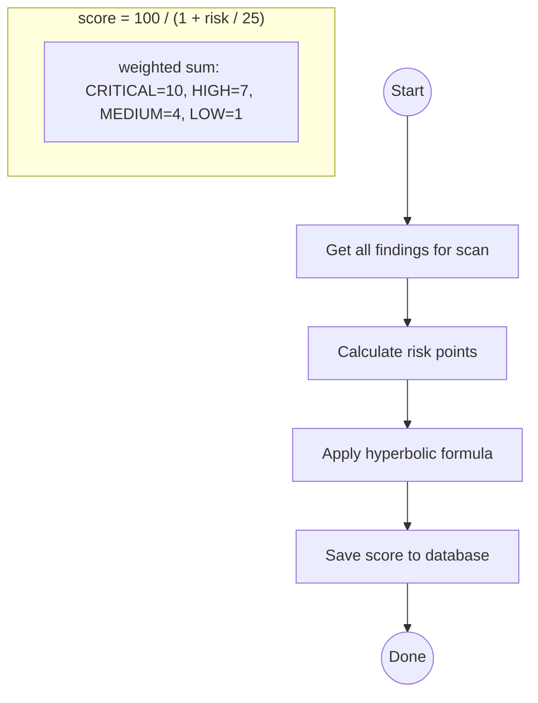
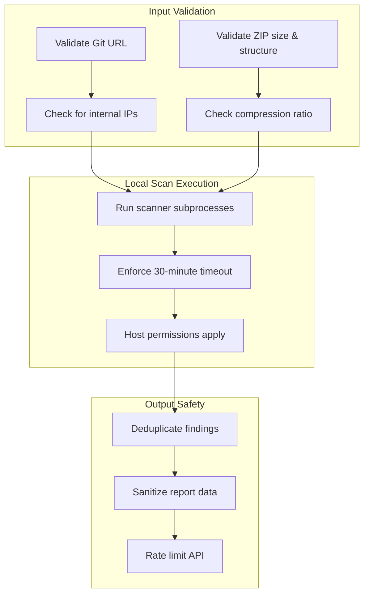

# SVS Code Flow Diagrams

These diagrams describe the current local-native workflow. Docker Compose,
Celery, Redis, and container-isolation diagrams from the previous deployment
have been removed; see the repository history for that architecture.

## System Architecture Overview



---

## End-to-End Scan Flow

```mermaid
sequenceDiagram
    participant User
    participant FE as Frontend
    participant API as FastAPI
    participant Worker as Local thread pool
    participant DB as SQLite
    participant Scanner

    User->>FE: Select Project / Upload ZIP
    FE->>API: POST /scans/git or /scans/upload
    API->>DB: Create Scan Record (status=PENDING)
    API->>Worker: Submit background task
    API-->>FE: Return scan_id

    Worker->>DB: Update Scan (status=RUNNING)
    Worker->>DB: Get Project Path
    
    Note over Worker: Run local scanner commands
    Worker->>Scanner: Run Semgrep SAST
    Scanner-->>Worker: Return findings
    Worker->>DB: Save findings
    Note over Scanner,DB: Non-fatal Semgrep warnings are saved with the scan; blocking errors fail the scanner

    Worker->>Scanner: Run Gitleaks
    Scanner-->>Worker: Return findings
    Worker->>DB: Save findings

    Worker->>Scanner: Run Dependency Audit
    Scanner-->>Worker: Return findings
    Worker->>DB: Save findings

    Note over Worker: Deduplicate & Score
    Worker->>DB: Calculate Score
    Worker->>DB: Update Scan (status=COMPLETED)

    Note over User: Polling from Frontend
    User->>FE: Poll GET /scans/{id}
    FE->>API: Request scan status
    API->>DB: Get scan data
    API-->>FE: Return status + findings
    FE-->>User: Display Report

```

---

## Scanner Pipeline Flow



---

## Database Schema Flow



---

## API Endpoints Flow

```mermaid
flowchart TD
    subgraph "Project Endpoints"
        P1[GET /projects]
        P2[POST /projects]
    end

    subgraph "Scan Endpoints"
        S1[GET /scans]
        S2[GET /scans/{id}]
        S3[POST /scans/git]
        S4[POST /scans/upload]
        S5[POST /scans/demo]
    end

    subgraph "Finding Endpoints"
        F1[GET /scans/{id}/findings]
        F2[PATCH /scans/{id}/findings/{finding_id}]
    end

    subgraph "Export Endpoints"
        E1[GET /scans/{id}/export]
        E2[GET /scans/{id}/export/sarif]
    end

    P1 --> P2
    S1 --> S2
    S3 --> S4
    S5 --> S2
    F1 --> F2
    E1 --> E2
```

---

## Frontend Component Flow



---

## Local Background Task Flow



---

## Score Calculation Flow



---

## Security Flow



---

## Local Development

`run-svs.bat` launches the FastAPI API and Vite frontend. The API dispatches
scans to an in-process thread pool and stores records in SQLite; no Docker
daemon, Redis, or Celery process is used.
